# :card_index_dividers: The Amazing Race Dataset & AI Training Corpus :checkered_flag: 
[](https://github.com/nicholaswilde/the-amazing-race/actions/workflows/ci.yml)
[](https://taskfile.dev/#/)
[](https://the-amazing-race.streamlit.app/)
[](https://coveralls.io/github/nicholaswilde/the-amazing-race?branch=main)
[](https://nicholaswilde.r-universe.dev/theamazingrace)
[](https://doi.org/10.5281/zenodo.23074890)

A comprehensive tidy dataset and AI training corpus for the CBS reality competition television series **[The Amazing Race](https://en.wikipedia.org/wiki/The_Amazing_Race_(American_TV_series))**.

Inspired by [doehm/alone](https://github.com/doehm/alone), this repository provides structured, relational datasets in tidy format (available in both **CSV** and **Apache Parquet**) alongside JSONL corpora designed for **LLM fine-tuning, RAG (Retrieval-Augmented Generation), and pre-training**.

> [!WARNING]
> This project is currently in a `v0.X.X` development stage. Features and configurations are subject to change, and breaking changes may be introduced at any time.

---

## :card_index_dividers: Architecture & Dataset Schema

The dataset is partitioned into clean relational tables adhering to tidy data principles:

### Tidy Datasets (`data/processed/`)

> **Comprehensive Documentation**: See the [Data Dictionary & Schema Reference](docs/data_dictionary.md) for complete column descriptions, primary/foreign keys, and Entity-Relationship diagrams across all 7 tables.  
> **Interactive Web Dashboard**: Try the live deployment at **[the-amazing-race.streamlit.app](https://the-amazing-race.streamlit.app/)** or launch locally via `task dashboard` (Catppuccin Mocha theme) to explore seasons 1–39, live empirical predictions, and challenge analytics.  
> **Interactive Notebook**: Check out [`notebooks/tar_exploration.ipynb`](notebooks/tar_exploration.ipynb) for a reference starter guide covering racing averages, route maps, and data analysis.

All processed tables are provided in **CSV**, **Apache Parquet**, **Apache Arrow IPC** (`data/processed/arrow/`), and native **R** formats (`.rds` and `.rda` in `data/processed/r/`), alongside a unified **SQLite** relational database (`data/processed/tar.db`) and an integrated **GeoJSON** geographic dataset (`data/processed/tar_routes.geojson`) with global flight paths and pit stop coordinates.

| Dataset | Formats | Description |
| :--- | :--- | :--- |
| **`seasons`** | `.csv`, `.parquet`, `.arrow`, `.rds`, `.rda`, `tar.db` | Season-level summary: franchise country (`version`), season number, winner names, total legs, teams count, route distance (miles & km), filming dates, and broadcast dates. |
| **`episodes`** | `.csv`, `.parquet`, `.arrow`, `.rds`, `.rda`, `tar.db` | Episode broadcast metadata, titles (racer quotes), air dates, and Nielsen television viewership ratings (millions). |
| **`contestants`** | `.csv`, `.parquet`, `.arrow`, `.rds`, `.rda`, `tar.db` | Individual racer demographics: unique `contestant_id`, full name, age, relationship, hometown, and final finish status. |
| **`teams`** | `.csv`, `.parquet`, `.arrow`, `.rds`, `.rda`, `tar.db` | Team-level profiles: `team_id`, member pairing, relationship type, final standing/placement, legs won, and total legs completed. |
| **`legs`** | `.csv`, `.parquet`, `.arrow`, `.rds`, `.rda`, `tar.db`, `.geojson` | Leg itineraries: origin and destination countries/cities, WGS84 geographic coordinates (`destination_lat`, `destination_lon`), number of route stops, challenge count, and narrative summary. |
| **`leg_results`** | `.csv`, `.parquet`, `.arrow`, `.rds`, `.rda`, `tar.db` | Granular leg finish placements for every team: placement rank (1st, 2nd, etc.), Non-Elimination Leg (NEL) saves, Fast Forward usage, U-Turns, and Speed Bumps. |
| **`tasks`** | `.csv`, `.parquet`, `.arrow`, `.rds`, `.rda`, `tar.db` | Detailed challenges: Detours, Roadblocks, Route Info, Speed Bumps, and Fast Forwards with full task descriptions. |

### AI Training Corpora & Benchmarks (`data/ai/`)

| File | Format | Use Case | Description |
| :--- | :--- | :--- | :--- |
| **`tar_qa_finetuning.jsonl`** | Chat JSONL | SFT / Instruction Tuning | High-quality multi-turn question-answer pairs formatted for OpenAI / Gemini fine-tuning covering winners, rules, eliminations, routes, and challenges. |
| **`tar_knowledge_corpus.jsonl`** | JSONL | RAG / Embeddings / Pre-training | Structured narrative documents with metadata (season, leg, route) suitable for vector database retrieval and context injection. |
| **`tar_benchmark_suite.jsonl`** | JSONL | Evaluation & Benchmarking | 45 curated evaluation benchmark questions with rubrics, scoring trivia, rules comprehension, and route accuracy. |
| **`huggingface/`** | Arrow Datasets | HF `datasets` Direct Loading | Ready-to-load HuggingFace Datasets disk bundles for high-throughput training. |
| **[`llms.txt`](llms.txt)** | Text / Markdown | LLM Context Index | Standardized compact index and link manifest conforming to the [`/llms.txt`](https://llmstxt.org) standard for fast agent context ingestion. |
| **[`llms-full.txt`](llms-full.txt)** | Text / Markdown | Zero-Hop LLM Context | Standalone, complete repository reference, data dictionary, CLI guide, and analytical formulas for LLM context windows. |

#### Direct Loading with Hugging Face `datasets`

The dataset is published to the Hugging Face Hub at [nicholascwilde/the-amazing-race](https://huggingface.co/datasets/nicholascwilde/the-amazing-race) and can be loaded directly in Python without manual downloads:

```python
from datasets import load_dataset

# Load any tidy relational table:
seasons = load_dataset("nicholascwilde/the-amazing-race", "seasons", split="train")
teams = load_dataset("nicholascwilde/the-amazing-race", "teams", split="train")

# Load instruction-tuning conversational pairs (SFT) & RAG knowledge documents:
qa = load_dataset("nicholascwilde/the-amazing-race", "qa_finetuning", split="train")
knowledge = load_dataset("nicholascwilde/the-amazing-race", "knowledge_corpus", split="train")
```

### Companion R Data Package (`r/`)

A companion R package, **`theamazingrace`**, is located in the [`r/`](r/) directory, providing instant access to all 7 tidy datasets following the conventions of reality TV data packages (`alone`, `survivoR`, `bakeoff`):

```r
# Install from R-universe (automated multi-platform binary builds for Windows, macOS, Linux, WebR):
install.packages("theamazingrace", repos = "https://nicholaswilde.r-universe.dev")

# Or install development version directly from GitHub:
remotes::install_github("nicholaswilde/the-amazing-race/r")

# Load library and datasets:
library(theamazingrace)
data(seasons)
data(episodes)
```

Direct high-performance columnar reading in R without loading package `.rda` objects is also supported via `{arrow}`:
```r
library(arrow)
seasons <- read_parquet("data/processed/seasons.parquet")
```

---

## :bar_chart: Data Visualizations & Exploratory Analysis

Inspired by [`doehm/alone`](https://github.com/doehm/alone), the repository includes publication-quality visualizations and exploratory analyses generated from the historical tidy tables. All figures are rendered at 300 DPI and stored in [`dev/images/`](dev/images/):

### Team Survival Curves Across Legs

Step-down team survival curves across Legs 0–12 by relationship archetype (Dating, Siblings, Married, Friends, Parent/Child) alongside an inset distribution of total legs completed:

<p align="center">
  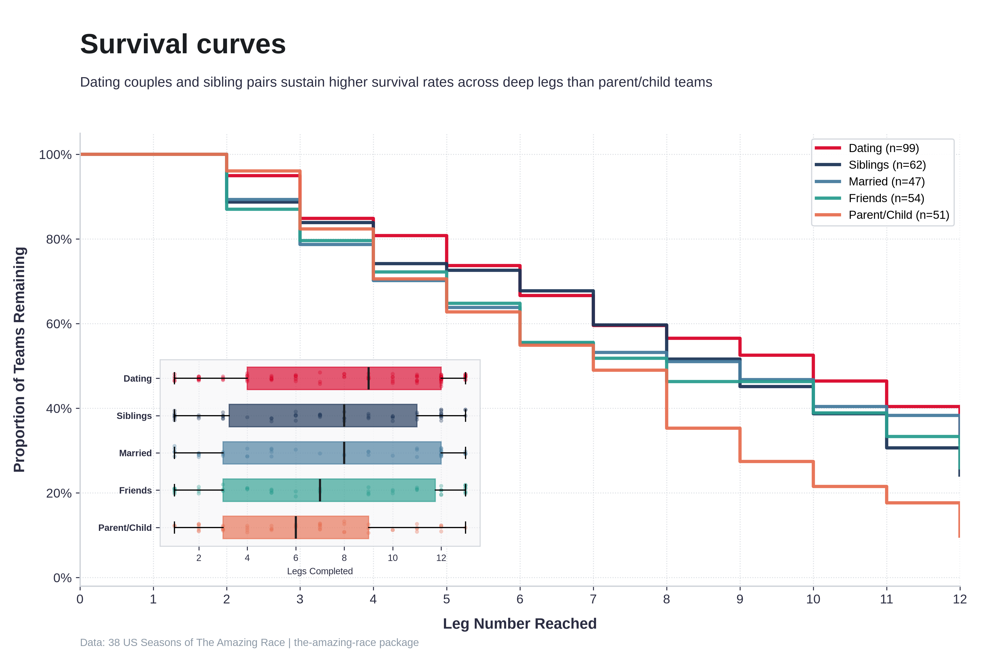
</p>

### Most Visited Destination Countries

Total leg appearances across all 453 race legs spanning 38 US seasons:

<p align="center">
  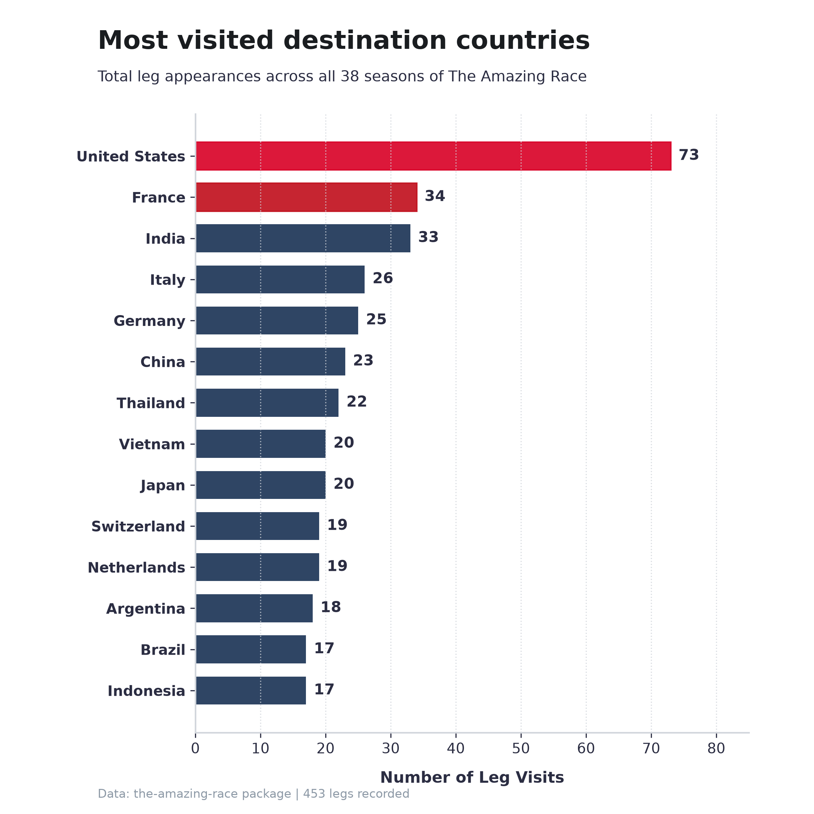
</p>

### Racer Age Distributions by Finish Placement

Boxplot distributions and jittered racer data comparing championship winners and podium finalists against mid-pack and early elimination tiers:

<p align="center">
  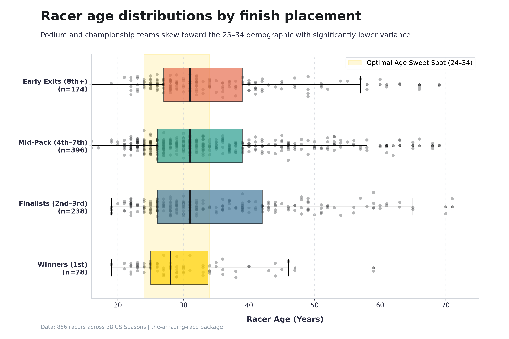
</p>

### Team Gender Dynamics & Performance

Empirical distributions of racing averages, podium conversion rates, and championship win shares comparing All-Male (MM), Co-Ed (MF), and All-Female (FF) teams across 431 teams:

<p align="center">
  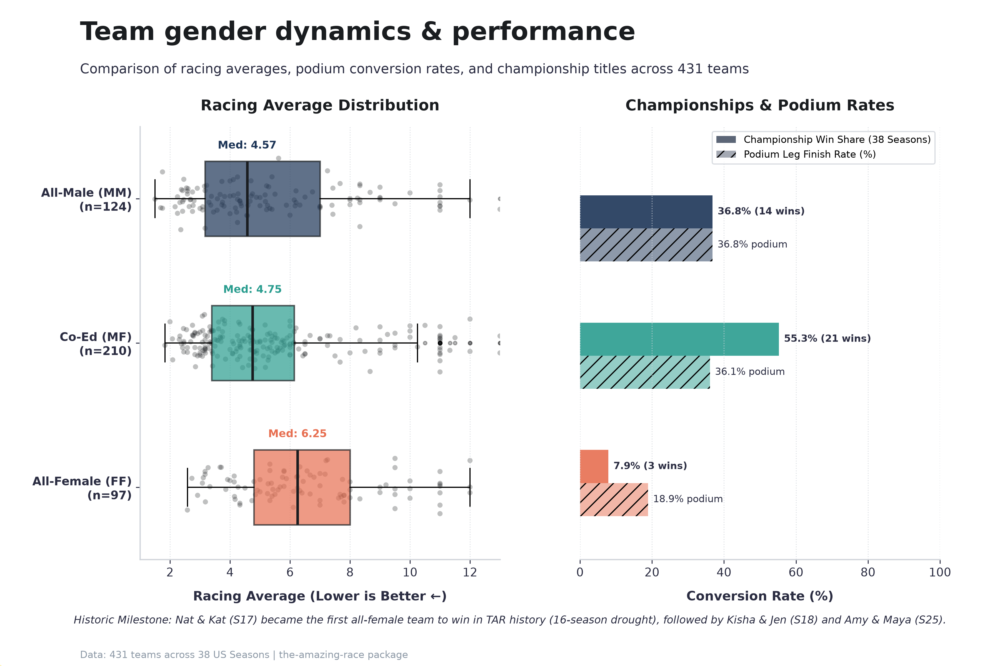
</p>

### Roadblock Task Balance & Equity Evolution

Historical trajectory of partner task equity before and after the landmark Season 6 Roadblock Rule change, highlighting the elimination of single-partner task dominance and the resulting gender workload parity:

<p align="center">
  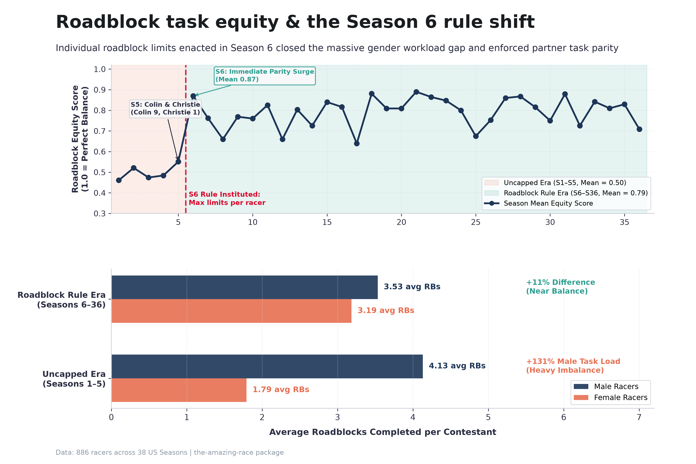
</p>

### Physical vs. Mental Roadblock Selection Dynamics

Empirical analysis of 1,109 Roadblock tasks across 38 US seasons evaluating partner task choice in co-ed (MF) teams and its relationship with race outcomes:

<p align="center">
  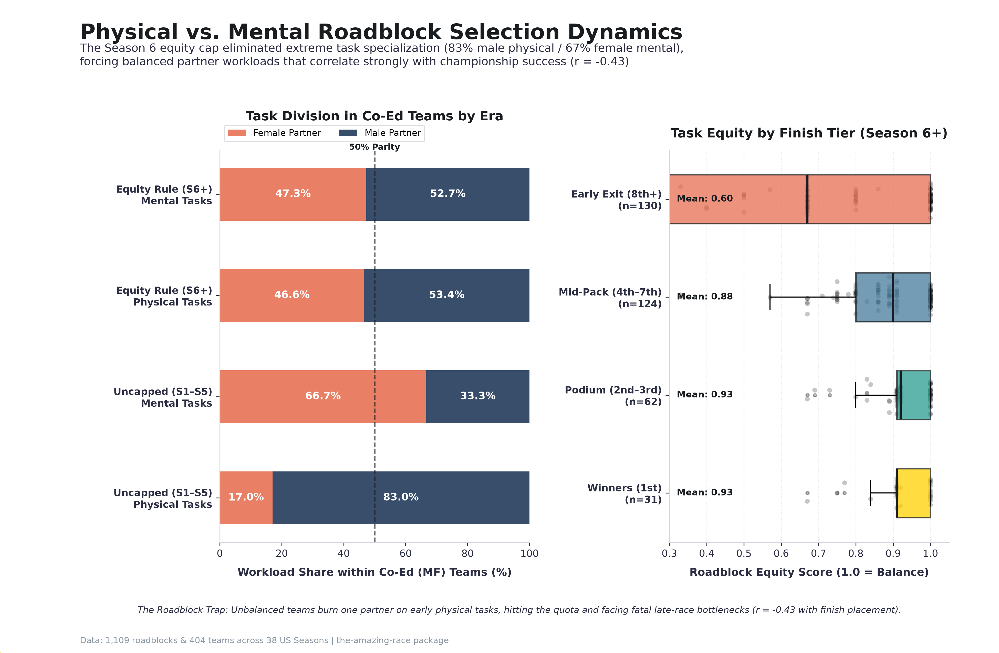
</p>

- **Gender Division of Labor**: Prior to Season 6 (uncapped era), co-ed teams exhibited extreme task specialization—men performed **83.0%** of physical challenges (climbing, rowing, carrying) while women performed **66.7%** of mental challenges (puzzles, decoding, memorization).
- **Rule-Driven Parity**: Instituting individual Roadblock caps in Season 6 structurally eliminated extreme specialization, shifting co-ed workloads to near 50/50 balance across both physical (53.4% M / 46.6% F) and mental tasks (52.7% M / 47.3% F).
- **Championship Correlation ($r = -0.43$)**: Season 6+ championship winners maintain a mean Roadblock equity score of **0.93** versus **0.78** for non-winners. Teams that exhaust one racer's quota on early physical tasks hit a bottleneck in late legs, forcing the unprepared partner into decisive mental or physical challenges with elevated elimination risk.

### Express Pass Strategic Impact & Survival Dynamics

Empirical analysis of 55 Express Pass plays across 38 US seasons and international franchises evaluating single-leg safety and final championship outcomes:

<p align="center">
  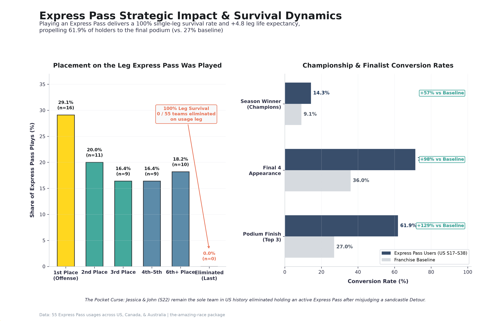
</p>

- **100% Single-Leg Survival**: Across all 55 documented Express Pass plays (21 in completed US seasons), **zero teams** have ever been eliminated on the leg they played their pass. Average placement on the usage leg is **2.43** (with 29.1% finishing 1st to capture leg victory prizes).
- **Subsequent Life Expectancy**: Teams that successfully burn an Express Pass survive an average of **+4.8 additional legs**, with **61.9%** reaching the final podium (top 3) versus the 27.0% franchise baseline (+129% boost), and **14.3%** going on to win the championship.
- **The Pocket Curse**: The primary elimination hazard associated with an Express Pass is hoarding it rather than playing it. Jessica & John (Season 22, Leg 4) remain the sole team in US history eliminated while holding an active Express Pass in their possession.

### Speed Bump Penalty Efficacy & Post-NEL Survival Lag

Empirical hazard and survival analysis of 44 Speed Bump penalty instances across US Seasons 12–32 evaluating single-leg safety, post-NEL life expectancy, and championship conversion:

<p align="center">
  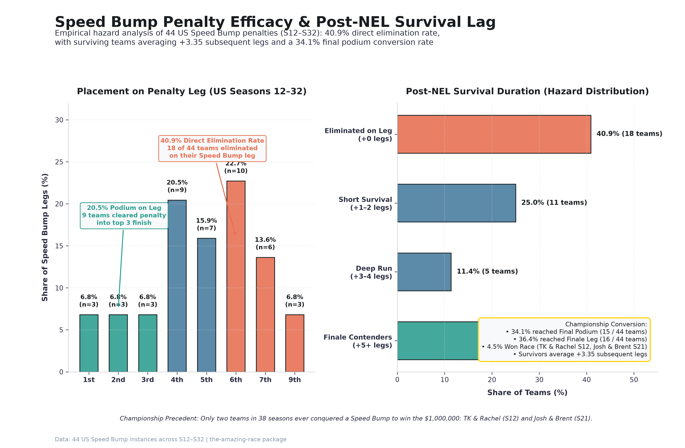
</p>

- **40.9% Direct Elimination Rate**: Unlike the Express Pass (which guarantees 100% leg survival), the Speed Bump imposes a substantial single-leg hazard: **18 of 44 teams (40.9%)** were eliminated on the exact leg they performed their penalty. Average placement on the penalty leg drops to **4.95** (median: 5.0), with 68.2% of teams finishing 5th or worse.
- **Survivors' Extended Runway (+3.35 Legs)**: For the 26 teams (59.1%) that clear the Speed Bump leg, the penalty does not mean immediate departure. Surviving teams endure an average of **+3.35 subsequent legs** (overall cohort mean: 1.98 legs), with 10 teams surviving 5 or more additional legs into the penultimate and finale legs.
- **Podium & Championship Conversion**:
  - **Final Podium (Top 3)**: **15 of 44 teams (34.1%)** successfully reached the final podium despite incurring an earlier Speed Bump penalty.
  - **Championship Winners (4.5%)**: Exactly two teams in 38 seasons overcame a Speed Bump to win the $1,000,000 championship: **TK & Rachel** (Season 12, Leg 10 Speed Bump) and **Josh & Brent** (Season 21, Leg 6 Speed Bump).

### U-Turn Lethality, Retaliation Dynamics & Defensive Burn Strategy

Empirical analysis of 61 US U-Turn victims (91 across US, Canada, and Australia) evaluating single-leg elimination rates, placement recovery, Double U-Turn defensive burning vs. cascade chaining, and Blind vs. Public retaliation hazards:

<p align="center">
  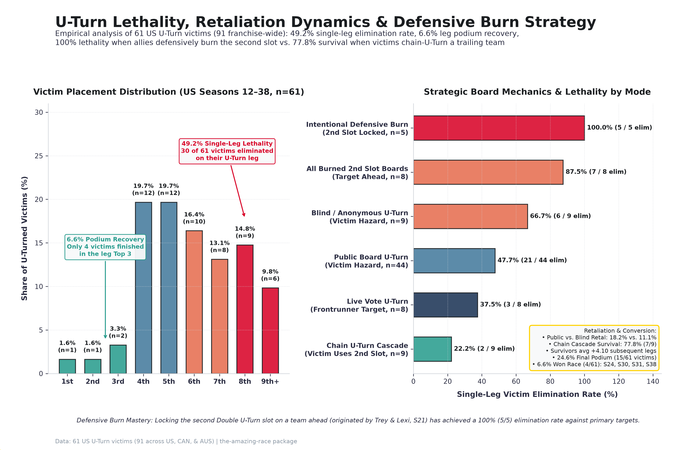
</p>

- **49.2% Single-Leg Lethality & 6.6% Podium Recovery**: Forcing a team to complete both branches of a Detour eliminates **30 of 61 US victims (49.2%)** on that exact leg (42.9% across all 91 franchise instances). Mean leg placement drops to **5.92** (median: 6.0), and only **4 of 61 victims (6.6%)** ever recover to finish on the leg podium (top 3).
- **Defensive Burning vs. Chain Cascades in Double U-Turns**:
  - **Chain U-Turn Cascade (77.8% Survival)**: When the primary victim reaches a Double U-Turn board before the second slot is taken and U-Turns a trailing team behind them (`⊂ ⊃`, 9 US instances), the primary victim survives **77.8% (7 of 9)** of the time (76.9%, 10 of 13 franchise-wide).
  - **Intentional Defensive Burn (100.0% Lethality)**: When an allied or leading team defensively burns the second slot on a team already ahead of them (5 US instances: Trey & Lexi S21, Caroline & Jennifer S24, Burnie & Ashley S28, Becca & Floyd S29, Riley & Maddison S32), the primary victim is denied the cascade safety valve and is eliminated **100.0% (5 of 5)** of the time (87.5%, 7 of 8 across all burned second-slot boards).
- **Blind vs. Public Retaliation & Championship Conversion**:
  - **Retaliation Hazard**: Teams executing a **Public U-Turn** face an **18.2%** downstream retaliation rate on subsequent U-Turn/Yield boards versus **11.1%** for anonymous **Blind U-Turn** users, while Blind U-Turns prove more lethal to victims (**66.7%** elimination vs. **47.7%** on public boards and **37.5%** on Live Vote boards).
  - **Championship Winners (6.6%)**: Surviving US victims endure an average of **+4.10 subsequent legs**, with **15 of 61 (24.6%)** reaching the final podium and **4 teams (6.6%)** winning the championship: **Dave & Connor** (S24), **Cody & Jessica** (S30), **Colin & Christie** (S31), and **Jas & Jag** (S38).

### Fast Forward Timing Optimization, Prize Capture & Title Conversion

Empirical analysis of 54 US Fast Forward plays (64 across US, Canada, and Australia) evaluating single-leg 1st-place prize capture, timing optimization across Early/Mid/Late race tiers, and the Season 5 scarcity rule shift:

<p align="center">
  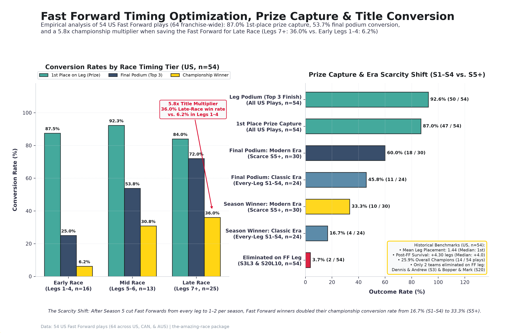
</p>

- **87.0% Leg Win (Prize Capture) & 92.6% Leg Podium Rate**: Bypassing all remaining route markers via a Fast Forward propels **47 of 54 US teams (87.0%)** directly to a 1st-place Pit Stop finish and leg prize capture (84.4%, 54 of 64 franchise-wide), with **50 of 54 (92.6%)** finishing in the leg top 3 (mean placement: **1.44**, median: **1.0**). Only **2 teams (3.7%)** in US history were ever eliminated on their Fast Forward leg: **Dennis & Andrew** (S3, Leg 3 — delayed by ferry/train transit to 10th) and **Bopper & Mark** (S20, Leg 10 — finished 5th).
- **The 5.8x Late-Race Championship Multiplier**:
  - **Early Race (Legs 1–4, n=16)**: While early Fast Forward plays capture 1st place on the leg **87.5%** of the time, burning the one-per-race advantage early yields only a **25.0% final podium rate** (4 of 16) and a **6.2% championship win rate** (1 of 16: Rob & Brennan, S1 Leg 1).
  - **Mid Race (Legs 5–6, n=13)**: Mid-season plays achieve a **92.3% leg win rate**, **53.8% final podium rate** (7 of 13), and **30.8% championship win rate** (4 of 13).
  - **Late Race (Legs 7+, n=25)**: Saving the Fast Forward for high-leverage late-race legs (`7+`) yields a **72.0% final podium rate** (18 of 25) and a **36.0% championship win rate** (9 of 25) — a **5.8x championship multiplier** compared to early-race plays.
- **The Season 5 Scarcity Shift & 14 US Champions**:
  - **Classic Era (S1–S4, Every-Leg Availability, n=24)** vs. **Modern Scarce Era (S5+, 1–2 per Season, n=30)**: When production reduced Fast Forwards from every leg (S1–S4) to at most 1–2 per season starting in Season 5, final podium conversion rose from **45.8% to 60.0%** and championship conversion doubled from **16.7% (4 of 24)** to **33.3% (10 of 30)**.
  - **Overall Championship Conversion (25.9%)**: Fast Forward winners survive an average of **+4.30 subsequent legs** (median: +4.0), with **29 of 54 (53.7%)** reaching the final podium and **14 teams (25.9%)** winning the $1,000,000 championship: **Rob & Brennan** (S1), **Chris & Alex** (S2), **Flo & Zach** (S3), **Reichen & Chip** (S4), **Uchenna & Joyce** (S7), **BJ & Tyler** (S9), **Tyler & James** (S10), **Nick & Starr** (S13), **Meghan & Cheyne** (S15), **Dan & Jordan** (S16), **Nat & Kat** (S17), **Rachel & Dave** (S20), **Bates & Anthony** (S22), and **Carson & Jack** (S37).

### First Leg Winner Trajectory & The "Episode 1 Curse" Myth

Empirical evaluation of the long-standing fan hypothesis regarding the "First Leg Winner Curse" ("Episode 1 Jinx") across 41 US Leg 1 winners (431 completed US teams) and 59 franchise-wide Leg 1 winners (623 completed teams across US, Canada, and Australia):

<p align="center">
  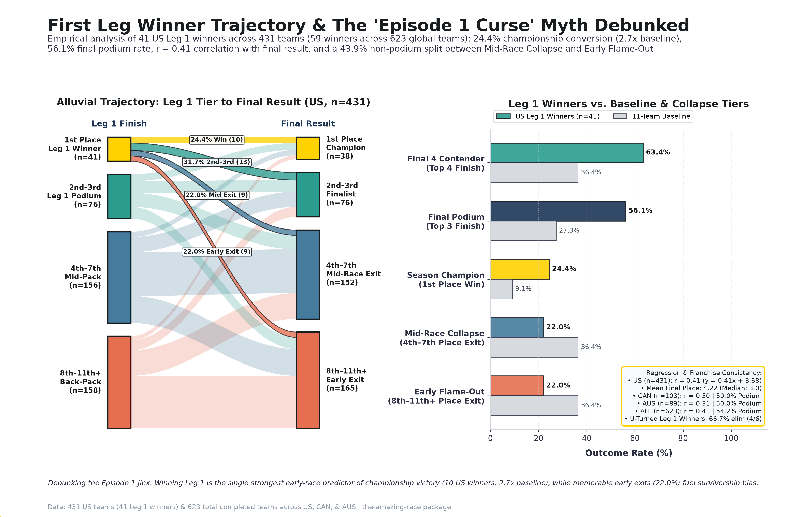
</p>

- **Curse vs. Signal (2.7x Championship Multiplier)**: Far from a jinx, winning Leg 1 is the single strongest early-race signal of championship superiority. Across 41 US Leg 1 winners (38 seasons, including Season 4's three-way tie and Season 37's dual Fork in the Road winners), **10 teams (24.4%)** went wire-to-wire to win the $1,000,000 championship—**2.68x** the 9.1% (1-in-11) baseline—and **23 teams (56.1%)** reached the final podium (top 3), **2.06x** the 27.3% baseline (mean final placement: **4.22**, median: **3.0**). The 10 US Leg 1 winners who won their season are **Rob & Brennan** (S1), **Tyler & James** (S10), **Nick & Starr** (S13), **Meghan & Cheyne** (S15), **Ernie & Cindy** (S19), **Rachel & Dave** (S20), **Dana & Matt** (S28), **Derek & Claire** (S34), **Carson & Jack** (S37), and **Jas & Jag** (S38).
- **Anatomy of the "Episode 1 Curse" (Mid-Race Collapse vs. Early Flame-Out)**:
  - The 18 US Leg 1 winners (**43.9%**) that failed to reach the finale podium split evenly into two distinct collapse tiers:
    - **Early Flame-Out Tier (8th–11th Place, 22.0%, 9 of 41)**: Teams eliminated between Legs 2 and 4—including **Amanda & Chris** (S4, Leg 2), **Alison & Donny** (S5, Leg 2), **Debbie & Bianca** (S7, Leg 3), **Rob & Amber** (S11 All-Stars, Leg 4), **Jessica & John** (S22, Leg 4 holding an Express Pass), **Seth & Olive** (S29, Leg 3 U-Turn), **Anthony & Spencer** (S33, Leg 3), and **Jocelyn & Victor** (S35, Leg 4). These high-profile early shocks drive cognitive availability bias behind the fan "curse" narrative.
    - **Mid-Race Collapse Tier (4th–7th Place, 22.0%, 9 of 41)**: Frontrunners eliminated in Legs 6–11 (**Millie & Chuck** S4, **Hayden & Aaron** S6, **Godlewski Family** S8, **Azaria & Hendekea** S12, **Jordan & Jeff** S16, **Abbie & Ryan** S21, **Jet & Cord** S24, **Tanner & Josh** S27, and **Alyssa & Josiah** S37).
  - **U-Turn Target Hazard (66.7% Lethality)**: Winning Leg 1 paints a visible target on frontrunners when U-Turn boards appear: **6 of 41 US Leg 1 winners (14.6%)** were subsequently U-Turned, and **4 of those 6 (66.7%)** were eliminated on that exact leg (**Abbie & Ryan** S21L9, **Jet & Cord** S24L10, **Tanner & Josh** S27L9, and **Seth & Olive** S29L3), exceeding the 49.2% US baseline U-Turn lethality rate.
- **Leg 1-to-Final Correlation & International Franchise Consistency**:
  - **US (`n=431` completed teams)**: Leg 1 placement correlates strongly with final season standing (**Pearson `r = 0.4102`**, OLS regression: `final_result = 0.4149 * leg1_placement + 3.6772`). Teams finishing Leg 1 in the Back-Pack (8th+) win the season only **4.4%** of the time (7 of 158) and suffer an Early Exit (8th+) **57.0%** of the time (90 of 158).
  - **International Consistency (`ALL`, `n=623` completed teams)**: Across all 623 completed teams (635 total teams), Leg 1 placement maintains **Pearson `r = 0.4055`** (`final_result = 0.4247 * leg1_placement + 3.6425`), with **Canada (`CAN`, `n=103`)** exhibiting `r = 0.4959` (**20.0%** champion, **50.0%** podium among 10 Leg 1 winners) and **Australia (`AUS`, `n=89`)** exhibiting `r = 0.3147` (**12.5%** champion, **50.0%** podium among 8 Leg 1 winners).

### Detour Branch Switching Penalties, Task Archetypes & Sunk-Cost Thresholds

Empirical analysis of 1,110 Detour branches across 555 Detours (758 US branches across 379 US Detours) and 3,563 non-finale Detour team-legs (2,499 US) evaluating task archetype selection, 100%-avoided branches, mid-leg branch switching / bottleneck drops, forced dual-branch U-Turn penalties, and the sunk-cost survival curve:

<p align="center">
  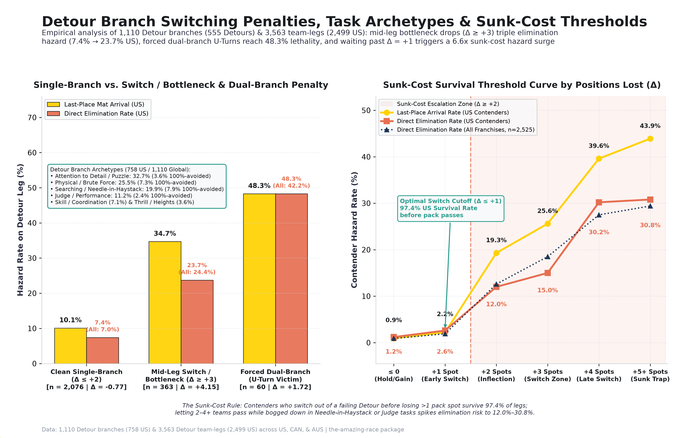
</p>

- **Task Archetype Distribution & 100%-Avoided Branches (`46` US / `48` Global)**:
  - **Attention to Detail / Puzzle (`32.7%` US / `34.8%` Global, 248 US / 386 Global branches)**: The most common Detour archetype (assembly, replication, counting, sorting) has a low **3.6%** complete-avoidance rate (9 US branches unchosen; 2.6% globally).
  - **Physical / Brute Force (`25.5%` US / `23.2%` Global, 193 US / 257 Global branches)**: Heavy hauling, long hikes, and endurance labor exhibit a **7.3%** US complete-avoidance rate (14 US branches where zero teams completed the slow/grueling option when paired against a faster alternative).
  - **Searching / Needle-in-Haystack (`19.9%` US / `19.1%` Global, 151 US / 212 Global branches)**: High-variance unbounded search tasks exhibit a **7.9%** US complete-avoidance rate (12 US branches unchosen) and represent the primary source of voluntary mid-leg abandonment and sunk-cost traps.
  - **Judge / Performance (`11.2%` US / `13.2%` Global, 85 US / 147 Global branches)**: Choreography, singing, and memorization tasks lure teams in with the lowest initial avoidance rate (**2.4%** US / **1.4%** Global), but strict subjective judging frequently creates mid-task bottlenecks.
  - **Skill / Coordination (`7.1%` US, 9.3% avoided)** & **Thrill / Heights (`3.6%` US, 14.8% avoided)**: High-skill navigation/aiming and extreme height drops polarize selection based on racer phobias and technical proficiency.
- **Single-Branch Execution vs. Mid-Leg Switch / Bottleneck Collapse vs. Forced Dual-Branch (U-Turn)**:
  - **Clean Single-Branch Execution ($\Delta \le +2$ positions, `n=2,076` US / `2,945` Global)**: Teams completing their chosen branch cleanly improve their leg placement by an average of **-0.77 positions** (`4.57 -> 3.80` US; `-0.80` globally), facing only a **10.1%** last-place arrival rate and **7.4%** direct elimination rate (7.0% globally).
  - **Mid-Leg Switch / Bottleneck Drop ($\Delta \ge +3$ positions without U-Turn, `n=363` US / `528` Global)**: Front- and mid-pack teams (entering at mean placement **2.52** US) that bog down and switch Detour branches mid-leg collapse to an average finish of **6.67** (**+4.15 positions lost**), tripling last-place mat arrival to **34.7%** and direct elimination to **23.7%** (**3.2x** the clean single-branch baseline; 24.4% globally).
  - **Forced Dual-Branch Execution (U-Turn Victim, `n=60` US / `90` Global)**: Teams forced to backtrack and complete both Detour branches drop from **4.12 to 5.83** (**+1.72 positions lost**), suffering a **48.3%** US last-place and direct elimination rate (**6.5x** clean single-branch baseline; 42.2% globally).
- **The Sunk-Cost Survival Threshold Curve (When Does Failing to Switch Become Fatal?)**:
  - Tracking top/mid-pack contenders entering a Detour leg outside the bottom 2 (`n=1,773` US / `2,525` Global):
    - **$\Delta \le 0$ (Hold or Gain Position, `n=907` US)**: **0.9%** last-place arrival, **1.2%** direct elimination (0.9% globally).
    - **$\Delta = +1$ (1 Team Passes — Optimal Early Switch Cutoff, `n=270` US)**: Cutting losses and switching before losing more than 1 pack position preserves a **97.4% US survival rate** (**2.2%** last-place, **2.6%** eliminated; 1.9% globally).
    - **$\Delta = +2$ (2 Teams Pass — Sunk-Cost Inflection Point, `n=233` US)**: Waiting until 2 trailing teams pass triggers a **6.6x global / 4.6x US elimination hazard surge** (**19.3%** last-place, **12.0%** eliminated US; 12.6% globally).
    - **$\Delta = +3$ (3 Teams Pass — Switch Danger Zone, `n=160` US)**: **25.6%** last-place arrival, **15.0%** eliminated US (18.5% globally).
    - **$\Delta = +4$ to $+5+$ (4+ Teams Pass — Fatal Sunk-Cost Trap, `n=203` US)**: Once 4 or more teams pass a bogged-down contender at a Detour, last-place arrival surges to **39.6%–43.9%** and direct elimination reaches **30.2%–30.8%** US (27.5%–29.4% globally).

### Global Race Footprint by Continent

All-time leg destinations across 6 continents and the historical evolution of race routing from early global dispersal to modern and post-COVID charter flight routing:

<p align="center">
  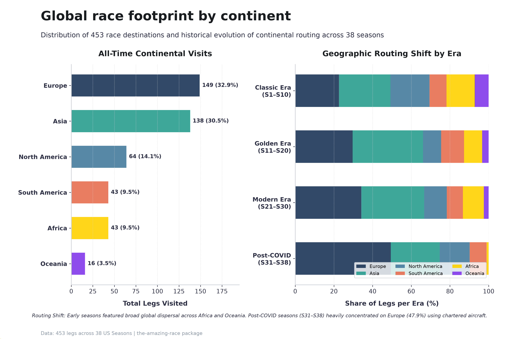
</p>

> [!TIP]
> All figures and branding assets can be generated or customized via `task images` (or `python dev/scripts/generate_images.py`).

---

## :crystal_ball: Empirical Season Predictions

<!-- TAR_PREDICTIONS_START -->
### :trophy: Live Empirical Predictions (Season 39 - After Leg 4)

Probabilistic forecasts computed via multi-factor log-odds calibrated against 38 historical seasons. See [docs/predictions.md](docs/predictions.md) for full weekly trajectory ledgers and outcome accuracy tracking.

| Rank | Team | Relationship | Avg Age | Avg Place | Express Pass | Win Prob | Finale Prob (Top 3) |
| :---: | :--- | :--- | :---: | :---: | :---: | :---: | :---: |
| 1 | **Michelle & Matt** | Married Parents | 34 | 3.0 | Held | **22.1%** | **66.9%** |
| 2 | **Erin & Javi** | Married | 29 | 4.8 | Used | **19.9%** | **60.7%** |
| 3 | **Conner & Garrett** | Childhood Friends | 27 | 5.0 | Held | **15.7%** | **49.0%** |
| 4 | **Daisha & Dalton** | Dating | 28 | 7.8 | Used | **12.0%** | **38.6%** |
| 5 | **Ali & Joanna** | Pro Athletes/Moms | 43 | 5.5 | Held | **10.2%** | **33.6%** |
| 6 | **Ann-Marie & Riley** | Mother & Daughter | 42 | 4.8 | Used | **6.9%** | **24.3%** |
| 7 | **Anuar & Andrea** | Father & Daughter | 42 | 4.5 | Used | **6.6%** | **23.5%** |
| 8 | **Dafina & Saran** | Sisters/Best Friends | 52 | 8.2 | Used | **3.8%** | **15.6%** |
| 9 | **Doug & Dylan** | Grandfather & Grandson | 46 | 8.2 | Used | **2.8%** | **12.8%** |

> [!NOTE]
> Predictions update automatically after each broadcast episode via `task ingest:run` or `task predict -- --update-docs`. See [docs/predictions.md](docs/predictions.md) for all historical leg snapshots.
<!-- TAR_PREDICTIONS_END -->

---

## :package: Release Asset Packages

Pre-built distribution bundles are published with every [GitHub Release](https://github.com/nicholaswilde/the-amazing-race/releases). You can download and use these standalone assets immediately without cloning the repository or setting up the development environment.

| Package | Asset Pattern | Format | Primary Use Case |
| :--- | :--- | :--- | :--- |
| **Tidy CSV Bundle** | `tar-dataset-csv-<version>.zip` | CSV + Markdown | Universal data analysis (Python, R, Excel, Google Sheets, BI tools) |
| **Apache Parquet Bundle** | `tar-dataset-parquet-<version>.zip` | Apache Parquet | High-performance analytics (DuckDB, Polars, PyArrow, Pandas) |
| **SQLite Database** | `tar-dataset-sqlite-<version>.zip` | SQLite (`tar.db`) | Relational SQL querying, database browsers, local apps |
| **AI Training Corpus** | `tar-dataset-ai-<version>.zip` | JSONL | LLM fine-tuning, RAG vector search, benchmark evaluation |
| **R Data Package** | `theamazingrace_<version>.tar.gz` | R Source Tarball | Native R data package (`library(theamazingrace)`) |
| **Python Package** | `the_amazing_race-<version>-py3-none-any.whl`<br>`the_amazing_race-<version>.tar.gz` | Wheel / Sdist | Standalone `tar-dataset` CLI and Python schemas library |
| **Integrity & Metadata** | `checksums.txt`<br>`manifest.json` | Text / JSON | SHA-256 verification and dataset build metadata |

---

### 1. Tidy CSV Bundle (`tar-dataset-csv-<version>.zip`)

Contains all 7 relational tidy datasets (`seasons.csv`, `episodes.csv`, `contestants.csv`, `teams.csv`, `legs.csv`, `leg_results.csv`, `tasks.csv`), the data dictionary, and global route GIS features (`tar_routes.geojson`).

```bash
# Extract archive
unzip tar-dataset-csv-*.zip
```

- **Python (Pandas)**:
  ```python
  import pandas as pd

  seasons = pd.read_csv("seasons.csv")
  teams = pd.read_csv("teams.csv")
  winners = teams[teams["winner"] == 1]
  ```

- **R (`readr` / `tidyverse`)**:
  ```r
  library(readr)
  library(dplyr)

  seasons <- read_csv("seasons.csv")
  teams <- read_csv("teams.csv")
  ```

- **Spreadsheets / BI**: Import directly into Microsoft Excel, Google Sheets, Tableau, or Power BI.

---

### 2. Apache Parquet Bundle (`tar-dataset-parquet-<version>.zip`)

Contains columnar Apache Parquet files preserving strict data types, nested fields, columnar compression, and `tar_routes.geojson` for zero-copy high-throughput and GIS analysis.

```bash
# Extract archive
unzip tar-dataset-parquet-*.zip
```

- **DuckDB (Direct SQL)**:
  ```python
  import duckdb

  # Query parquet files directly with SQL without loading into memory:
  duckdb.sql("""
      SELECT season, winner, legs, countries_visited
      FROM 'seasons.parquet'
      ORDER BY season ASC
  """).show()
  ```

- **Polars / Pandas**:
  ```python
  import polars as pl
  seasons = pl.read_parquet("seasons.parquet")

  import pandas as pd
  teams = pd.read_parquet("teams.parquet")
  ```

- **GIS Mapping (GeoPandas / Folium / QGIS)**:
  ```python
  import geopandas as gpd

  # Load all 38 flight routes and 453 waypoint coordinates:
  gdf = gpd.read_file("tar_routes.geojson")
  routes = gdf[gdf["feature_type"] == "route"]
  waypoints = gdf[gdf["feature_type"] == "waypoint"]
  ```

- **R (`arrow`)**:
  ```r
  library(arrow)
  seasons <- read_parquet("seasons.parquet")
  ```

---

### 3. SQLite Database Bundle (`tar-dataset-sqlite-<version>.zip`)

Contains a ready-to-query, indexed SQLite relational database (`tar.db`) with primary/foreign keys configured across all 7 tables.

```bash
# Extract archive
unzip tar-dataset-sqlite-*.zip
```

- **Command Line (`sqlite3`)**:
  ```bash
  sqlite3 -header -column tar.db "
    SELECT season, winner, destination_summary
    FROM seasons
    LIMIT 5;
  "
  ```

- **Python (`sqlite3`)**:
  ```python
  import sqlite3
  import pandas as pd

  conn = sqlite3.connect("tar.db")
  query = """
    SELECT t.team_name, t.season, t.racing_average, s.winner
    FROM teams t
    JOIN seasons s ON t.season = s.season
    WHERE t.winner = 1
    ORDER BY t.racing_average ASC
  """
  winning_teams = pd.read_sql_query(query, conn)
  conn.close()
  ```

- **GUI Clients**: Open directly with [DB Browser for SQLite](https://sqlitebrowser.org/), DBeaver, or Datasette (`datasette tar.db`).

---

### 4. AI Training & Fine-Tuning Corpus (`tar-dataset-ai-<version>.zip`)

Contains JSONL corpora optimized for training, fine-tuning, and evaluating Large Language Models:

- **`tar_qa_finetuning.jsonl`**: Supervised fine-tuning (SFT) conversation pairs formatted with multi-turn messages (system, user, assistant) for OpenAI, Gemini, Claude, or local model tuning (Unsloth, Axolotl).
- **`tar_knowledge_corpus.jsonl`**: Curated reference knowledge documents with rich metadata (`season`, `leg`, `route`) for semantic search, vector indexing, and RAG pipelines (LangChain, LlamaIndex, ChromaDB, Qdrant).
- **`tar_benchmark_suite.jsonl`**: 45 evaluation questions with verified ground truths and rubrics covering game rules, racing statistics, route itineraries, and trivia.

```bash
# Extract archive
unzip tar-dataset-ai-*.zip
```

- **Inspect Fine-Tuning Pairs**:
  ```bash
  head -n 2 tar_qa_finetuning.jsonl
  ```

- **Load Knowledge Corpus in Python**:
  ```python
  import json

  # Load documents for RAG vector embedding:
  with open("tar_knowledge_corpus.jsonl", "r", encoding="utf-8") as f:
      corpus = [json.loads(line) for line in f]

  print(f"Loaded {len(corpus)} knowledge documents.")
  print("Sample document:", corpus[0]["text"][:200])
  ```

---

### 5. Companion R Package Source (`theamazingrace_<version>.tar.gz`)

A CRAN-compliant R source package archive containing all 7 datasets pre-loaded as native `.rda` objects with comprehensive Roxygen documentation and dataset schemas.

- **Install from Downloaded Release Asset**:
  ```r
  install.packages("theamazingrace_0.1.0.tar.gz", repos = NULL, type = "source")
  ```

- **Install Direct from GitHub (Development)**:
  ```r
  remotes::install_github("nicholaswilde/the-amazing-race/r")
  ```

- **Usage in R**:
  ```r
  library(theamazingrace)

  # Load datasets
  data(seasons)
  data(teams)
  data(leg_results)

  # View help pages and schema definitions
  ?seasons
  ?teams
  ```

---

### 6. Python Distribution Wheel & Sdist (`.whl` and `.tar.gz`)

Pre-compiled Python packages that allow installing the `tar_dataset` library and `tar-dataset` CLI directly via `pip` or `uv` without cloning the repository.

- **Installation**:
  ```bash
  # Using uv:
  uv pip install the_amazing_race-0.1.0-py3-none-any.whl

  # Or using pip:
  pip install the_amazing_race-0.1.0-py3-none-any.whl
  ```

- **Use the CLI**:
  ```bash
  # Inspect seasons, teams, and challenges:
  tar-dataset inspect season 1
  tar-dataset inspect team "Rob & Amber"

  # Display dataset statistics:
  tar-dataset stats

  # Audit dataset completeness:
  tar-dataset audit
  ```

- **Use the Python Library**:
  ```python
  from tar_dataset.schemas import Season, Team, LegResult
  ```

---

### 7. Integrity Checksums & Manifest (`checksums.txt`, `manifest.json`)

Every release includes cryptographic hashes and build metadata to verify package authenticity and inspect schema versions.

- **Verify Asset Integrity**:
  ```bash
  # Verify all downloaded files against SHA-256 checksums:
  sha256sum --check checksums.txt
  ```

- **Inspect Manifest Metadata**:
  ```bash
  # Inspect table row counts, file sizes, and release metadata:
  jq . manifest.json
  ```

---

## :runner: Quick Start with `uv` & `task`

This repository uses [`uv`](https://docs.astral.sh/uv/) for Python packaging and [`go-task`](https://taskfile.dev/) (`task`) as the task runner.

### Prerequisites

Ensure `uv` and `task` are installed:
```bash
# Install uv
curl -LsSf https://astral.sh/uv/install.sh | sh

# Install task (macOS / Linux via Homebrew, or see https://taskfile.dev/installation/)
brew install go-task
```

### Installation

Clone and initialize the virtual environment with all extras:
```bash
git clone https://github.com/nicholaswilde/the-amazing-race.git
cd the-amazing-race
task sync
```

---

## :hammer_and_wrench: Task Runner (`task`)

All repository workflows can be driven directly via `task`:

```bash
task                  # List all available tasks
task check            # Run linting, test suite, and dataset validation
task test             # Run pytest test suite
task test:coverage    # Run pytest with branch test coverage reporting
task coverage:report  # Generate HTML test coverage report (htmlcov/)
task coverage:upload  # Upload coverage results to Coveralls.io
task lint             # Lint Python code with ruff and check spelling with typos
task lint:fix         # Fix ruff issues and typo spelling errors automatically
task spellcheck       # Check spelling with typos across the repository
task spellcheck-file FILE=path/to/file # Check spelling on a specific file
task format           # Format code with ruff
task pipeline         # Full end-to-end rebuild: build, export all formats, eval, and check
task build            # Compile raw data into tidy CSV + Parquet + SQLite tables
task export:sqlite    # Export unified SQLite bundle (tar.db)
task export:arrow     # Export Apache Arrow IPC files and HuggingFace datasets
task export:r         # Export native R datasets (.rds, .rda) and companion package (r/)
task export:ai        # Export fine-tuning and RAG JSONL corpora
task export:geojson   # Export GeoJSON routes and pit stop coordinates (tar_routes.geojson)
task package          # Build all segmented release bundles and checksums
task package:csv      # Build tidy CSV release bundle
task package:parquet  # Build Parquet columnar release bundle
task package:ai       # Build AI training datasets bundle
task package:r        # Build R companion source package tarball
task release          # Automated release tagging, validation, and bump (./scripts/release.sh)
task release:summary  # Generate categorized release notes and update draft release
task eval:benchmark   # Evaluate 45 curated AI benchmark questions
task validate         # Verify dataset schema and relational integrity
task stats            # Show table row counts and summary stats
task predict          # Predict upcoming/in-progress season outcomes (e.g. -- --season 39)
task predict:update   # Run predictions and update documentation ledger (README & docs/predictions.md)
task dashboard        # Launch interactive web dashboard for race exploration & predictions
task publish:hf       # Publish and sync tidy datasets & AI corpora to Hugging Face Hub
task publish:space    # Deploy interactive dashboard to Hugging Face Spaces
task images           # Generate publication-quality figures and branding assets (dev/images/)
task scrape:wiki      # Scrape Wikipedia seasons (pass args via --, e.g. -- --season 1)
task scrape:fandom    # Scrape Fandom Wiki infoboxes
task scrape:reddit    # Scrape Reddit discussion threads
task import:sheet     # Import community Google Sheets or external CSVs
task codegraph:status # Inspect CodeGraph index status
```

---

## :computer: CLI Usage

All tasks are also accessible through the direct `tar-dataset` CLI:

### 1. Scrape Wikipedia
Scrapes contestant demographics, results matrices, episode ratings, and leg task narratives:
```bash
# Scrape a specific season
uv run tar-dataset scrape-wiki --season 1

# Scrape all US seasons (1 through 36)
uv run tar-dataset scrape-wiki --start 1 --end 36

# Scrape international franchises (e.g. Canada)
uv run tar-dataset scrape-wiki --start 1 --end 10 --version CAN
```

### 2. Scrape Fandom Wiki
Extracts infoboxes, route coordinates, and show trivia from `amazingrace.fandom.com`:
```bash
uv run tar-dataset scrape-fandom --season 1
uv run tar-dataset scrape-fandom --start 1 --end 36
```

### 3. Scrape Reddit Discussions
Collects episode discussion threads, live broadcast reactions, post-episode debriefs, and racer AMAs from `r/TheAmazingRace`:
```bash
# Scrape official episode discussions
uv run tar-dataset scrape-reddit --query "Discussion Thread" --limit 50

# Scrape live broadcast reactions
uv run tar-dataset scrape-reddit --query "Live Discussion" --limit 50

# Scrape post-episode debriefs
uv run tar-dataset scrape-reddit --query "Post-Episode Discussion" --limit 50

# Scrape racer AMAs
uv run tar-dataset scrape-reddit --query "AMA" --limit 25

# Batch scrape all 4 discussion categories in one shot
task scrape:reddit:all
# or: uv run tar-dataset scrape-reddit --batch
```

### 4. Import Google Sheets & CSVs
Imports fan-maintained spreadsheets (leg times, detour choice stats, roadblock tallies):
```bash
uv run tar-dataset import-sheet \
  --url "https://docs.google.com/spreadsheets/d/<SHEET_ID>/edit#gid=0" \
  --name "tar_leg_times"
```

### 5. Build Tidy Datasets
Transforms cached raw scrapes into tidy CSV and Parquet files:
```bash
uv run tar-dataset build
```

### 6. Export AI Training Datasets
Generates conversational Q&A pairs and RAG knowledge corpora:
```bash
uv run tar-dataset export-ai
```

### 7. Validate Data Integrity
Checks relational consistency, missing values, and schema constraints:
```bash
uv run tar-dataset validate
```

### 8. Export SQLite Bundle
Generates the composite `tar.db` SQLite database:
```bash
uv run tar-dataset export-sqlite
# or via task:
task export:sqlite
```

### 9. Export Apache Arrow & HuggingFace Datasets
Serializes tables to `.arrow` files and builds HuggingFace disk datasets:
```bash
uv run tar-dataset export-arrow
# or via task:
task export:arrow
```

### 10. Export Native R Datasets & Companion Package (.rds, .rda)
Exports compressed `.rds` files to `data/processed/r/`, `.rda` objects to `r/data/`, and generates roxygen2 documentation:
```bash
uv run tar-dataset export-r
# or via task:
task export:r
```

### 11. Export GeoJSON Route Dataset
Exports global flight paths and pit stop coordinates to RFC 7946 GeoJSON:
```bash
uv run tar-dataset export-geojson
# or via task:
task export:geojson
```

### 12. Evaluate AI Benchmark Suite
Scores LLM trivia, rules comprehension, and route accuracy against 45 curated prompts:
```bash
uv run tar-dataset eval-benchmark
# or via task:
task eval:benchmark
```

### 13. Inspect Seasons, Teams, and Racers in the Terminal
Interactively inspect details, routes, and statistics with Rich terminal formatting:
```bash
# Inspect Season overview, legs itinerary, and leaderboard
uv run tar-dataset show season 1

# Inspect Team profile, members, racing average, and leg-by-leg placements
uv run tar-dataset show team "Rob & Brennan"

# Inspect Contestant profile
uv run tar-dataset show racer "Rob Frisbee"

# Inspect specific Leg challenges and narrative
uv run tar-dataset show leg 1 --season 1
```

### 14. View Dataset Statistics
```bash
uv run tar-dataset stats
```

### 15. Audit Dataset Gaps & Missingness
Identifies null cells, season-level missingness, and column completeness rates:
```bash
# Run full completeness audit across all 7 tables
uv run tar-dataset gaps
# or via task:
task gaps

# Drill down into specific tables or seasons
uv run tar-dataset gaps --table contestants
uv run tar-dataset gaps --season 29 --detail

# Export markdown audit report
uv run tar-dataset gaps --export-md docs/dataset_gaps.md
```

### 16. Package Release Distribution Bundles
Generates targeted asset packages for CSV, Parquet, AI corpora, R, and Python distributions with SHA-256 checksums:
```bash
# Package all distribution bundles
uv run tar-dataset package --version 0.1.0

# Package specific component
uv run tar-dataset package --component csv
uv run tar-dataset package --component parquet
uv run tar-dataset package --component ai
uv run tar-dataset package --component r
uv run tar-dataset package --component python
```

### 17. Publish & Synchronize to Hugging Face Hub
Publishes and syncs all tidy Parquet tables, AI training JSONL corpora, and generated dataset card to the Hugging Face Hub:
```bash
# Publish using HF_TOKEN environment variable (or .env):
uv run tar-dataset publish-hf
# or via task runner:
task publish:hf

# Publish to custom repository or private dataset:
uv run tar-dataset publish-hf --repo-id nicholascwilde/the-amazing-race --private

# Stage files locally to inspect generated dataset card and layout:
uv run tar-dataset publish-hf --stage-only dist/hf_staging
```

### 18. Interactive Web Dashboard

A live deployment is hosted on Streamlit Community Cloud at **[https://the-amazing-race.streamlit.app/](https://the-amazing-race.streamlit.app/)**.

You can also launch a local Streamlit web application styled in the **Catppuccin Mocha** theme for interactive race data exploration, empirical predictions, and challenge browsing:
```bash
# Launch dashboard on http://0.0.0.0:8501
task dashboard
# or via CLI:
uv run --extra dashboard tar-dataset dashboard

# Customize port and host, or run headless
uv run --extra dashboard tar-dataset dashboard --port 8502 --no-browser
```

#### Docker & Docker Compose Deployment

The dashboard is packaged as a multi-arch container image (`linux/amd64`, `linux/arm64`) published to GitHub Container Registry (`ghcr.io/nicholaswilde/the-amazing-race`) and Docker Hub (`nicholaswilde/the-amazing-race`):

```bash
# Run with Docker Compose:
docker compose up -d
# or via task runner:
task docker:up

# Run official container directly from GHCR:
docker run -d --name the-amazing-race -p 8501:8501 ghcr.io/nicholaswilde/the-amazing-race:latest

# Build and run locally via task runner:
task docker:build
task docker:run
```

Features included in the dashboard:
- **Catppuccin Mocha Theme**: Custom dark theme with Base (`#1e1e2e`), Mantle (`#181825`), Mauve (`#cba6f7`) accents, and coordinated Altair visualization palettes.
- **In-Progress Season Support**: Automatically detects and loads active, airing seasons (including Season 39) alongside historical seasons 1–38, displaying broadcast legs, current placements, and newly aired challenges.
- **Season Explorer**: Select seasons (1–38 and in-progress 39) to view interactive leg routes and destination maps, team placement trajectory line charts (1st place at top), full standings, and roadblock trackers with equity scores.
- **Interactive Predictor**: Contender rankings, win and finale probabilities, multi-factor breakdowns (momentum, age peak, relationship archetype, power items), diagnostic strengths/risks, and a custom "What-If" team simulator.
- **Challenge Browser**: Search, filter, and analyze 1,700+ challenges across Roadblocks, Detours, Fast Forwards, and Speed Bumps, with cross-season trend analytics and all-time top performer leaderboards.
- **Exploratory Analysis & Strategic Visualizations**: Interactive Catppuccin Mocha Altair charts and drill-down ledgers with live franchise filtering (`US`, `ALL`, `CAN`, `AUS`) across 5 empirical tabs: **Demographics & Survival** (Kaplan-Meier leg survival & Roadblock 50/50 workload equity), **Tactical Hazards** (`U-Turn` & `Speed Bump` lethality and survival lag), **Strategic Advantages** (`Fast Forward` timing windows & Season 5 scarcity shift), **Detour Switching & Sunk Cost** (task archetype avoidance & $\Delta$ survival threshold curve), and **Leg 1 Trajectory & Global Footprint** ("Episode 1 Curse" transition matrix & continental route visits).

### 19. Predict Race Outcomes & Track Weekly Accuracy
Evaluates active contenders using multi-factor empirical modeling (momentum, age peak, relationship archetype, Express Pass) and records weekly accuracy:
```bash
# Predict upcoming/in-progress season outcomes
uv run tar-dataset predict --season 39

# Inspect detailed demographic strengths and risk factors
uv run tar-dataset predict --season 39 --top 5 --detail

# Update documentation ledger (README.md & docs/predictions.md) and record weekly snapshot
uv run tar-dataset predict --season 39 --update-docs
# or via task runner:
task predict:update
```

### 20. Deploy Dashboard to Hugging Face Spaces
Deploys the interactive dashboard and its bundled datasets directly to a public or private Hugging Face Space running Streamlit:
```bash
# Deploy to Hugging Face Spaces (defaults to <username>/the-amazing-race-dashboard):
uv run tar-dataset publish-space
# or via task runner:
task publish:space

# Deploy to specific Space or as private:
uv run tar-dataset publish-space --repo-id nicholascwilde/the-amazing-race-dashboard --private

# Stage Space files locally to inspect Docker/container files without uploading:
uv run tar-dataset publish-space --stage-only dist/space_staging
```

---

## :robot: Agent / Antigravity Skills

For AI agents operating in this workspace, modular skills are available in `.agents/skills/`:
- **`tar-scrape-wiki`**: Instructions and commands for Wikipedia & Fandom extraction.
- **`tar-scrape-reddit`**: Extraction runbook for r/TheAmazingRace discussions.
- **`tar-import-sheets`**: Workflow for community Google Sheets and CSV import.
- **`tar-dataset-builder`**: Tidy data compilation, validation, and AI JSONL export.
- **`release`**: Automated version bumping, validation (`task check`), tagging, and atomic push.
- **`release-summary`**: Changelog formatting from git logs and GitHub draft release updating.

---

## :dash: Running Tests & Quality Checks

Run the test suite and quality checks via `task` or `pytest`:
```bash
# Run pytest test suite
task test
# or: uv run --extra dev pytest

# Run all quality checks (lint, format-check, tests, and dataset validation)
task check
```

---

## :books: Sources & References

This dataset synthesizes information from encyclopedic records, fan community databases, and discussion forums:

### 1. Primary Encyclopedic Records
- **[Wikipedia - The Amazing Race](https://en.wikipedia.org/wiki/The_Amazing_Race_(American_TV_series))**: Primary source for official season broadcast dates, episode titles, Nielsen television viewership ratings, contestant demographics, route itineraries, and elimination results matrices across US and international editions.
- **[The Amazing Race Fandom Wiki](https://amazingrace.fandom.com/)**: Detailed challenge descriptions, clue transcriptions, route marker locations, Detour options, Roadblock performers, Speed Bumps, Fast Forwards, and racer background trivia.

### 2. Fan Discussions & Commentary
- **[r/TheAmazingRace Subreddit](https://www.reddit.com/r/TheAmazingRace/)**: Source for episodic reaction threads, live discussions, post-episode analysis, and contestant AMA archives used in AI conversational training datasets.

### 3. Community Spreadsheets & Tracking Databases
- **[wavesei Comprehensive TAR Spreadsheet](https://docs.google.com/spreadsheets/d/1fiPwfl9fVSzrZbYn8IwbRWpV_5OUPl2A/edit)**: Challenge-by-challenge breakdowns, detour selections, roadblock tracking, finishing positions, leg-by-leg outcomes, and COVID-era season mechanics.
- **[TAR Statistics](https://docs.google.com/spreadsheets/d/1UEZRVYLCDnWjBhrDWxRar_dvUrkgcsqP1CREOkHHSc4/edit)**: Historical statistics covering US and international franchises, age gap vs. placement, gender performance metrics, returning racer records, top-3 relative ranks, and racing averages.
- **[The Amazing Race Placement Database](https://docs.google.com/spreadsheets/d/1jjp3mq4uTThVx3IArUE-wOktGKO_zsr3KWfefGPLM8Q/edit)**: Relational tables of seasons, teams, racers, legs, and placements across global franchises.

### 4. Architectural & Schema Inspiration
- **[doehm/alone](https://github.com/doehm/alone)**: Reference package architecture for tidy TV survival and reality show datasets in R and Parquet.
- **[doehm/survivoR](https://github.com/doehm/survivoR)**: Design principles for game show statistics and survival analytics.

---

## :bookmark: Citation

If you use this dataset, companion R package, or AI training corpus in your research, visualizations, or educational coursework, please cite it as:

```bibtex
@misc{wilde_amazing_race_2026,
  author       = {Nicholas Wilde},
  title        = {The Amazing Race Dataset & AI Training Corpus},
  year         = {2026},
  version      = {0.3.0},
  publisher    = {Zenodo},
  doi          = {10.5281/zenodo.23090022},
  url          = {https://github.com/nicholaswilde/the-amazing-race}
}
```

Or in APA format:
> Wilde, N. (2026). *The Amazing Race Dataset & AI Training Corpus* (Version 0.3.0) [Data set]. Zenodo. https://doi.org/10.5281/zenodo.23090022

> [!TIP]
> **Permanent Concept DOI**: Use [`10.5281/zenodo.23074890`](https://doi.org/10.5281/zenodo.23074890) to cite all versions of this dataset or link to the latest release automatically. For citing a specific version for reproducibility, use that release's version DOI (e.g. `10.5281/zenodo.23090022` for v0.3.0).

---

## :balance_scale: License

[Apache License 2.0](LICENSE)

## :writing_hand: Author

This project was started in 2026 by [Nicholas Wilde](https://github.com/nicholaswilde/).
